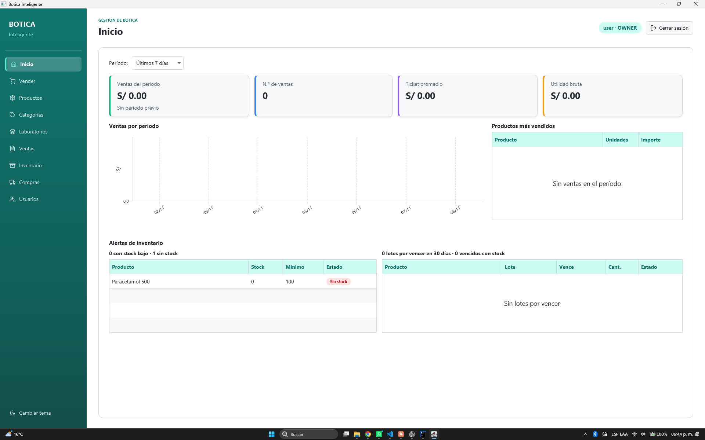
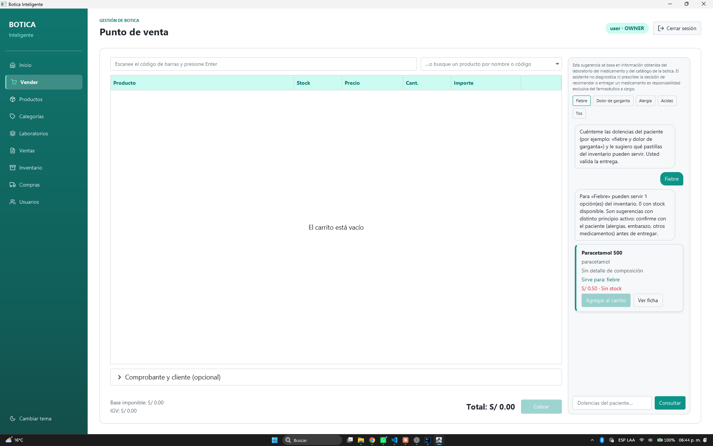
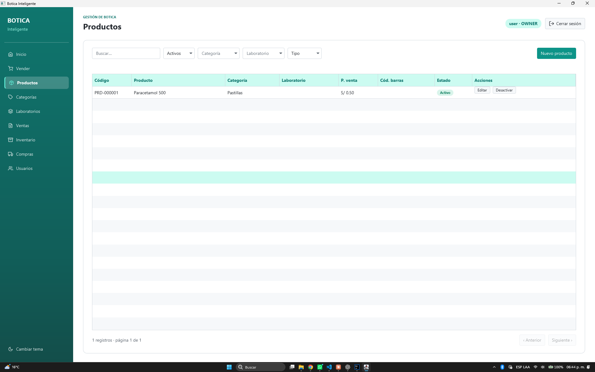
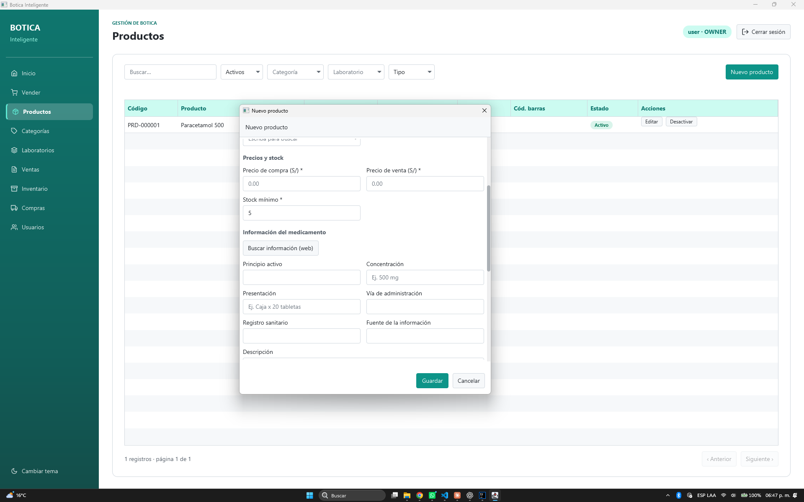
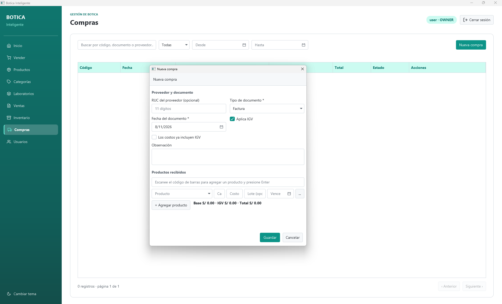
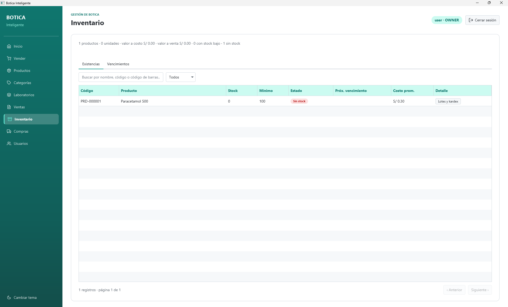

# 💊 Botica Inteligente

**El sistema de gestión para tu botica o farmacia independiente.**
Control de inventario con vencimientos, ventas rápidas, compras simplificadas y un asistente con IA que te ayuda a encontrar el producto correcto en segundos — todo en una sola aplicación de escritorio, sin depender de internet para trabajar.


**Tecnologías utilizadas:** Java 17 · Spring Boot 3.3 (sin servidor web) · JavaFX 21 + AtlantaFX · Ikonli · SQLite embebida · Flyway · Spring Data JPA + Hibernate · Spring Security Crypto (BCrypt) · OpenPDF · Jsoup · Lombok · Maven · JUnit 5.



---

## ¿Por qué Botica Inteligente?

Administrar una botica a mano (o con hojas de cálculo) significa perder ventas por falta de stock, vender productos vencidos sin darse cuenta y no tener claridad de cuánto se gana cada mes. **Botica Inteligente** resuelve esto con una aplicación pensada para el día a día de una botica real, no un ERP genérico sobredimensionado:

- ✅ **Control total del inventario**, por lotes y fechas de vencimiento.
- ✅ **Punto de venta rápido**, pensado para atender en segundos.
- ✅ **Asistente con IA** que sugiere qué productos sirven para una dolencia, con stock y precio en tiempo real.
- ✅ **Compras simples**, sin trámites innecesarios.
- ✅ **Dashboard** con las cifras clave del negocio, sin configuración.
- ✅ **Funciona sin internet** para toda la operación diaria (venta, inventario, compras).
- ✅ **Roles de usuario**: el dueño controla todo; el personal de venta solo opera lo que le corresponde.
- ✅ **Disponible en español e inglés**, configurable desde el login.

---

## Funcionalidades

### 🧠 Asistente de ventas con IA

El diferencial de Botica Inteligente. En la pantalla de **Vender**, el farmacéutico escribe o selecciona la dolencia del paciente ("fiebre", "dolor de garganta", etc.) y el asistente busca en el catálogo propio qué productos sirven, mostrando el principio activo, el stock disponible y el precio — listos para agregar al carrito con un clic.



> El asistente **no diagnostica ni prescribe**: solo acerca información ya cargada en el catálogo (de laboratorio o cargada manualmente) para que el farmacéutico de turno decida. La responsabilidad de la recomendación y la entrega es siempre de la persona a cargo — esto se muestra en cada respuesta, como respaldo legal del negocio.

### 📦 Catálogo de productos con código de barras

Alta de productos con generación automática de código interno, escaneo de código de barras EAN-13, categorías, tipo de producto y control de si requiere receta médica. El laboratorio o droguería es opcional, porque en la práctica muchas compras llegan de intermediarios.



### 🔎 Búsqueda web de información del medicamento

Al registrar un medicamento, un botón de **"Buscar información (web)"** permite traer indicaciones, contraindicaciones y advertencias desde internet para completar la ficha del producto — siempre mostrando el resultado para que el farmacéutico lo revise y edite antes de guardar. Nunca se guarda nada automáticamente.



### 🛒 Compras simplificadas

Registrar una compra toma segundos: tipo de comprobante (boleta, factura o recibo), fecha y los productos recibidos con su lote y vencimiento. El RUC del proveedor es opcional, para no frenar una compra urgente por no tener el dato a mano.



### 📊 Inventario con alertas de vencimiento

Visión clara del stock por producto y por lote, con alertas de stock bajo y de productos próximos a vencer — la causa más común de pérdidas en una botica.



### 📈 Dashboard gerencial

Ventas del período, número de tickets, ticket promedio y utilidad bruta de un vistazo, además de los productos más vendidos y las alertas de inventario que requieren atención.

### 👥 Roles y seguridad

Dos perfiles claramente diferenciados:

| Rol | Puede |
|---|---|
| **OWNER** (dueño) | Todo: productos, categorías, laboratorios, compras, usuarios y reportes completos |
| **SELLER** (vendedor) | Vender y consultar el catálogo e inventario, sin acceso a crear productos, compras ni usuarios |

Autenticación local con contraseñas cifradas (BCrypt) — no se depende de servicios externos para iniciar sesión.

---

## Por qué es una inversión segura

- **100% de escritorio, 100% tuyo.** Los datos de tu botica (ventas, clientes, inventario) se guardan en tu propia computadora, no en la nube de un tercero.
- **No necesita internet para trabajar.** Solo la búsqueda web opcional de información de medicamentos requiere conexión; el resto de la operación (ventas, inventario, compras, dashboard) funciona completamente offline.
- **Tecnología madura y probada**: Java 17, Spring Boot y SQLite — un stack estable, sin dependencias exóticas que puedan dejar de mantenerse.
- **Cobertura de pruebas automatizadas** sobre las reglas de negocio críticas (stock, precios, permisos), para evitar errores costosos.

---

## Stack técnico

| Componente | Tecnología |
|---|---|
| Interfaz de escritorio | JavaFX 21 + AtlantaFX + Ikonli (iconos) |
| Lógica de negocio | Java 17 + Spring Boot 3.3 (sin servidor web, `web-application-type=none`) |
| Persistencia | Spring Data JPA + Hibernate |
| Base de datos | SQLite embebida, con migraciones versionadas (Flyway) |
| Autenticación | BCrypt local (Spring Security Crypto), sin servicios externos |
| Comprobantes | OpenPDF (generación de PDF) |
| Búsqueda web de medicamentos | Jsoup |
| Empaquetado del instalable | jpackage (JDK 17) |
| Build | Maven |
| Pruebas | JUnit 5 |

---

## Descargas

¿No quieres compilar el proyecto? Descarga el instalador para Windows (incluye su propio runtime de Java, no requiere instalar JDK):

- **[BoticaInteligente-0.1.0.exe](../../releases)** — instalador nativo de Windows. Disponible en la sección [Releases](../../releases) del repositorio.

> Generado con `jpackage` + WiX Toolset a partir del JAR de la aplicación (`mvn clean package`). Instala la app, crea accesos directos y un desinstalador estándar de Windows.

---

## Instalación / Demo

**Requisitos:** JDK 17 y Maven.

```powershell
$env:JAVA_HOME="C:\Program Files\Microsoft\jdk-17.0.18.8-hotspot"
mvn javafx:run
```

En el primer arranque, la app solicita crear el usuario propietario (OWNER). La base de datos se crea automáticamente en `~/.botica-inteligente/botica.db` — no requiere instalar un gestor de base de datos aparte.

Para ejecutar las pruebas automatizadas:

```powershell
mvn clean test
```

---

## Configuración opcional

Personalizable desde `application.yml` o variables de entorno, sin tocar código:

| Propiedad | Por defecto | Uso |
|---|---|---|
| `botica.igv.tasa` | `0.18` | Tasa de IGV aplicada en compras y ventas |
| `botica.serie.boleta` | `B001` | Serie de las boletas de venta |
| `botica.serie.nota-venta` | `NV01` | Serie de las notas de venta |
| `botica.empresa.nombre`, `.ruc`, `.direccion`, `.telefono` | `Botica Inteligente` y vacíos | Datos del emisor que aparecen en el comprobante PDF |

---

## Estado del desarrollo

| Fase | Contenido | Estado |
|---|---|---|
| 1 | Base del proyecto, SQLite + Flyway, interfaz con tema | ✅ Hecha |
| 2 | Login local y roles (OWNER / SELLER) | ✅ Hecha |
| 3 | Catálogo: categorías, laboratorios, productos | ✅ Hecha |
| 4 | Inventario, lotes, kardex, compras | ✅ Hecha |
| 5 | Ventas / punto de venta | ✅ Hecha |
| 6 | Dashboard y escaneo de código de barras EAN-13 | ✅ Hecha |
| 7 | Asistente de consulta de medicamentos con IA | ✅ Hecha |
| 8 | Internacionalización (español / inglés) | ✅ Hecha |
| 9 | Búsqueda web de información de medicamentos | ✅ Hecha |

Plan completo y reglas de negocio detalladas: [MIGRACION.md](MIGRACION.md).

---

## Licencia

Proyecto de código abierto bajo licencia **MIT**. El software se entrega "tal cual" (*as is*), sin ninguna garantía expresa o implícita; el equipo de desarrollo no se hace responsable por daños, pérdidas o perjuicios derivados de su uso. Ver [LICENSE](LICENSE) para el texto completo.

## Aviso importante sobre el Asistente de IA

El **Asistente de Botica Inteligente** es una herramienta de apoyo informativo: **recomienda, no receta**. Sus sugerencias se basan en información cargada en el catálogo (de laboratorio o de internet, sujeta a revisión manual) y en ningún caso constituyen un diagnóstico, una indicación médica ni un reemplazo del criterio profesional.

- El uso de la aplicación, y en particular la dispensación de cualquier medicamento, **debe estar siempre acompañado y validado por un profesional químico farmacéutico autorizado**.
- La decisión final de recomendar, vender o entregar un medicamento es **responsabilidad exclusiva** de la persona autorizada a cargo en el punto de venta — nunca de la aplicación ni de sus desarrolladores.
- Los autores y colaboradores de este proyecto **no asumen responsabilidad alguna** por el uso indebido de la información mostrada, por decisiones de dispensación tomadas sin la validación de un profesional competente, ni por las consecuencias que de ello se deriven.

Este aviso se refuerza en pantalla: cada respuesta del Asistente incluye el mismo recordatorio para quien lo esté usando en el momento de la venta.
